<!-- ===================================================== -->
<!--                    ANIMATED HEADER                    -->
<!-- ===================================================== -->

<div align="center">


<br/>


<br/><br/>

<a href="https://rogerjaden-portfolio.onrender.com/">

</a>
<a href="https://www.linkedin.com/in/rogerjaden384">

</a>
<a href="mailto:rogerjaden384@gmail.com">

</a>
<a href="https://github.com/Rogerjaden">

</a>

<br/><br/>


</div>

---

<!-- ===================================================== -->
<!--                       ABOUT ME                        -->
<!-- ===================================================== -->

## About Me

I'm **Roger Jaden**, a Software Engineer focused on building reliable, scalable, and maintainable software systems.

My primary engineering focus is **Java backend development with Spring Boot**, complemented by full-stack development experience and practical exposure to AI/ML.

I enjoy understanding how software works beneath the surface — from database design, API architecture, authentication, and transaction management to application performance, system reliability, and scalability.

I approach software engineering with a product-oriented mindset: writing clean code, designing meaningful abstractions, solving real-world problems, and building applications that can evolve with growing requirements.

### Engineering Interests

- **Backend Engineering:** Building RESTful APIs, secure applications, and maintainable backend architectures.
- **Full Stack Development:** Connecting backend systems with responsive and functional frontend applications.
- **Database Engineering:** Relational database design, query optimization, indexing, and transaction management.
- **Distributed Systems:** Exploring caching, messaging, concurrency, and scalable system architecture.
- **AI / ML:** Practical experience with computer vision, deep learning, attention mechanisms, and hybrid neural architectures.
- **Product Engineering:** Turning requirements into functional applications with a focus on reliability and maintainability.

### Open To

- Software Engineer / SDE opportunities.
- Java Backend Developer roles.
- Full Stack Development opportunities.
- Open-source contributions and collaboration.
- Engineering projects involving scalable backend systems.

---

<!-- ===================================================== -->
<!--                      TECH STACK                       -->
<!-- ===================================================== -->

## Tech Stack

Technologies and tools I work with, grouped by engineering domain.

### Languages

<p align="center">

</p>

### Frontend Development

<p align="center">

</p>

### Backend & Databases

<p align="center">

</p>

### Cloud, DevOps & Tooling

<p align="center">

</p>

### Testing & Engineering Practices

<p align="center">


</p>

**Current learning / exploration:** Spring Cloud, Kubernetes, Jenkins, Kafka, Redis, distributed systems, and advanced system design.

---

<!-- ===================================================== -->
<!--                     AI / ML                           -->
<!-- ===================================================== -->

## AI / ML Expertise

My AI/ML experience is primarily project-based, with practical implementation experience in computer vision and deep learning.

| Domain | Proficiency | Details |
|:---|:---:|:---|
| Deep Learning | Project-based | Training and evaluating deep learning models |
| Computer Vision | Project-based | Image classification and medical image analysis |
| CNN Architectures | Project-based | ResNet50-based feature extraction |
| Attention Mechanisms | Project-based | CBAM attention modules |
| Transformer Models | Project-based | Transformer-based feature learning |
| Model Evaluation | Project-based | Accuracy measurement and classification evaluation |
| Explainable AI | Exposure | Grad-CAM experimentation |

**Primary AI/ML Project:** Deep Hybrid Model for Classification of Femoral Stem.

---

<!-- ===================================================== -->
<!--                   FEATURED PROJECTS                   -->
<!-- ===================================================== -->

## Featured Projects

A selection of engineering projects demonstrating backend development, full-stack implementation, database design, and applied machine learning.

<details>
<summary><b>01. CloudVault — Secure Cloud File Management Platform</b></summary>

<br/>

**Status:** In Development

CloudVault is a secure cloud file management application designed around reliable file operations, user authentication, and controlled access to stored resources.

The project emphasizes backend engineering fundamentals, clean architecture, data ownership, and secure file handling.

| Attribute | Details |
|:---|:---|
| **Stack** | Java, Spring Boot, Spring Security, Spring Data JPA, MySQL, React |
| **Scale** | MVP implementation |
| **Performance** | Not yet benchmarked |
| **Security** | Authentication, authorization, and resource ownership validation |
| **Impact** | Implements an end-to-end file management workflow |
| **Repository** | [Browse GitHub repositories](https://github.com/Rogerjaden?tab=repositories) |

**Engineering Highlights**

- Designed a relational data model for file and folder management.
- Implemented secure authentication and authorization.
- Developed file upload and download functionality.
- Implemented file ownership and access constraints.
- Structured backend services around maintainable application responsibilities.
- Focused on reliable storage operations and validation.

**Engineering Focus:** Backend architecture, file handling, security, database constraints, and API design.

</details>

<details>
<summary><b>02. BookMyShow Clone — Movie Ticket Booking Platform</b></summary>

<br/>

A full-stack movie ticket booking application inspired by real-world ticketing platforms.

The system focuses on booking workflows, seat availability, concurrent booking prevention, authentication, and payment integration.

| Attribute | Details |
|:---|:---|
| **Stack** | Java, Spring Boot, React, MySQL, Redis, JWT |
| **Scale** | Full-stack application |
| **Performance** | No verified benchmark published |
| **Security** | Spring Security, JWT authentication, role-based access |
| **Impact** | Implements movie discovery and ticket booking workflows |
| **Repository** | [Browse GitHub repositories](https://github.com/Rogerjaden?tab=repositories) |

**Engineering Highlights**

- Designed relational entities for movies, theatres, screens, seats, shows, and bookings.
- Implemented authentication and role-based authorization.
- Developed seat-locking functionality to prevent duplicate seat allocation.
- Designed booking and payment workflows.
- Integrated Razorpay payment functionality.
- Implemented email verification and notification workflows.
- Explored Redis for improving backend performance and managing frequently accessed data.
- Worked with concurrency and transaction management concepts.

**Engineering Focus:** Database design, concurrency, transaction management, authentication, and distributed application fundamentals.

</details>

<details>
<summary><b>03. Deep Hybrid Model — Classification of Femoral Stem</b></summary>

<br/>

<badge>93.37% Test Accuracy</badge>

An AI/ML research project focused on classifying femoral stem implant types using hip X-ray images.

The project explores hybrid deep learning architectures combining convolutional feature extraction, attention mechanisms, and Transformer modules.

| Attribute | Details |
|:---|:---|
| **Stack** | Python, PyTorch, ResNet50, CBAM, Transformer |
| **Scale** | 2,744 images across 3 classes |
| **Performance** | 93.37% test accuracy |
| **Security** | Not applicable to this model classification project |
| **Impact** | Automated classification of femoral stem implant categories |
| **Repository** | [View Source Code](https://github.com/Rogerjaden/Deep-Hybrid-Model-For-Classification-of-Femoral-Stem) |

**Engineering Highlights**

- Worked with anatomical, cemented, and uncemented femoral stem categories.
- Implemented a hybrid neural architecture.
- Explored ResNet50 for visual feature extraction.
- Integrated CBAM attention mechanisms.
- Incorporated Transformer-based feature learning.
- Evaluated model performance using test accuracy.
- Experimented with Grad-CAM for model interpretability.

**Engineering Focus:** Computer vision, deep learning, model architecture, feature extraction, and evaluation.

</details>

<details>
<summary><b>04. Dexter Builders — Business Website</b></summary>

<br/>

A responsive business website developed to establish an online presence for a construction and building services business.

The application focuses on presenting business information, showcasing projects, and providing an accessible customer-facing experience.

| Attribute | Details |
|:---|:---|
| **Stack** | React, JavaScript, HTML, CSS, Vite |
| **Scale** | Business website |
| **Performance** | No verified benchmark published |
| **Security** | Client-side input validation |
| **Impact** | Digital business presence and project presentation |
| **Repository** | [Browse GitHub repositories](https://github.com/Rogerjaden?tab=repositories) |

**Engineering Highlights**

- Developed responsive website sections.
- Implemented project presentation and image gallery functionality.
- Added customer contact functionality.
- Worked on form validation.
- Improved navigation and mobile responsiveness.
- Integrated business information and external links.

**Engineering Focus:** Frontend architecture, responsive UI, usability, and client-side development.

</details>

---

<!-- ===================================================== -->
<!--                      EXPERIENCE                       -->
<!-- ===================================================== -->

## Experience

### Independent Software Developer

**Independent Engineering Projects | Ongoing**

Focused on building software applications independently, strengthening engineering fundamentals, and translating technical requirements into functional solutions.

**Scope of Work**

- Design and implement backend applications using Java and Spring Boot.
- Develop REST APIs with authentication, authorization, and validation.
- Design relational database schemas and manage persistence using JPA and Hibernate.
- Build full-stack applications using React and Spring Boot.
- Explore application deployment, Docker, and cloud infrastructure.
- Implement practical software engineering concepts through end-to-end projects.
- Continuously improve code quality, testing practices, and application architecture.

**Engineering Skills**

`Java` `Spring Boot` `REST APIs` `Spring Security` `React` `MySQL` `PostgreSQL` `Docker` `Git`

---

<!-- ===================================================== -->
<!--                      ACHIEVEMENTS                     -->
<!-- ===================================================== -->

## Achievements

<div align="center">

| Recognition | Details |
|:---|:---|
| LeetCode | 248 problems solved |
| Deep Learning Project | 93.37% test accuracy |
| Dataset Processing | 2,744 medical X-ray images |
| Classification | 3 femoral stem categories |
| Engineering Projects | Multiple backend and full-stack implementations |
| Technical Development | Continuous exploration of backend engineering and system design |

</div>

---

<!-- ===================================================== -->
<!--                    CODING PROFILES                    -->
<!-- ===================================================== -->

## Coding Profiles

<div align="center">

<a href="https://leetcode.com/u/Rogerjaden/">

</a>

<br/><br/>

<a href="https://leetcode.com/u/Rogerjaden/">

</a>

</div>

---

<!-- ===================================================== -->
<!--                    GITHUB ANALYTICS                   -->
<!-- ===================================================== -->

## GitHub Analytics

<div align="center">



<br/><br/>



</div>

<div align="center">



<br/><br/>



</div>


---

<!-- ===================================================== -->
<!--                    GITHUB TROPHIES                    -->
<!-- ===================================================== -->

## GitHub Trophies

<div align="center">

<a href="https://github.com/Rogerjaden?tab=achievements">


</a>

</div>

---

<!-- ===================================================== -->
<!--                 CONTRIBUTION ACTIVITY                 -->
<!-- ===================================================== -->

## Contribution Activity

<div align="center">



<br/><br/>



</div>

---

<!-- ===================================================== -->
<!--                  CONTRIBUTION SNAKE                   -->
<!-- ===================================================== -->

## Contribution Snake

<div align="center">


</div>

---

<!-- ===================================================== -->
<!--                    CURRENT FOCUS                      -->
<!-- ===================================================== -->

## Current Focus

```yaml
developer:
  name: Roger Jaden
  primary_role: Software Engineer
  specialization: Java Backend Development

learning:
  - Data Structures and Algorithms
  - System Design
  - Distributed Systems
  - Microservices Architecture
  - Advanced Spring Boot
  - Database Optimization
  - Cloud Infrastructure

building:
  - CloudVault
  - Scalable Backend Applications
  - Full Stack Applications
  - Production-oriented Engineering Projects

exploring:
  - Redis
  - Apache Kafka
  - Spring Cloud
  - Kubernetes
  - AWS
  - Open Source Development

open_to:
  - Software Engineering Opportunities
  - Java Backend Roles
  - Full Stack Engineering
  - Open Source Contributions
  - Technical Collaboration
```

---

<!-- ===================================================== -->
<!--                       CONNECT                         -->
<!-- ===================================================== -->

## Connect With Me

I'm always interested in discussing software engineering, backend architecture, interesting technical problems, and open-source collaboration.

<div align="center">

<a href="mailto:rogerjaden384@gmail.com">

</a>

<a href="https://www.linkedin.com/in/rogerjaden384">

</a>

<a href="https://github.com/Rogerjaden">

</a>

<a href="https://rogerjaden-portfolio.onrender.com/">

</a>

<br/><br/>

**Let's build something meaningful.**

</div>

---

<!-- ===================================================== -->
<!--                         FOOTER                        -->
<!-- ===================================================== -->

<div align="center">

*“Great software is not just written. It is engineered with clarity, reliability, and purpose.”*

<br/>


</div>
